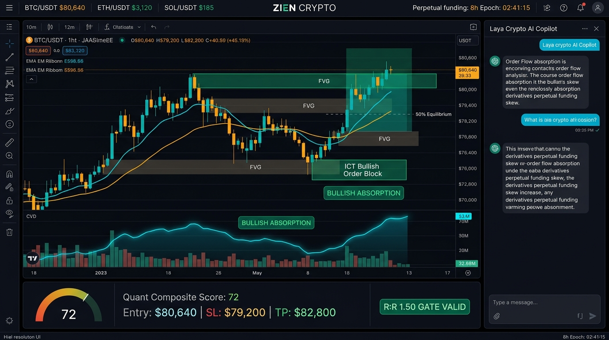
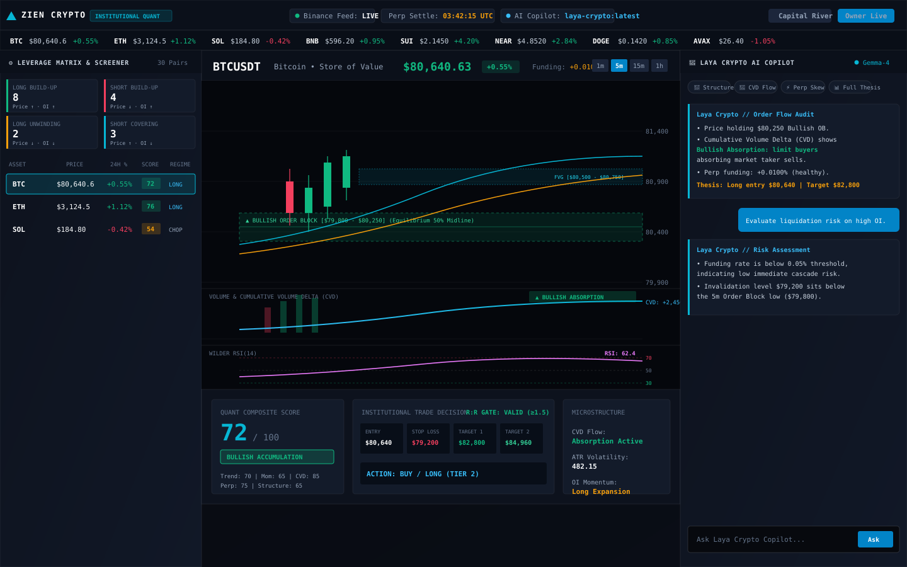
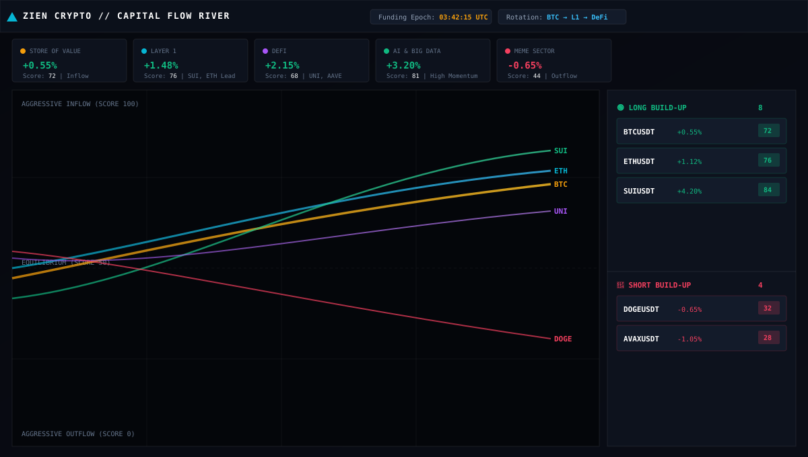
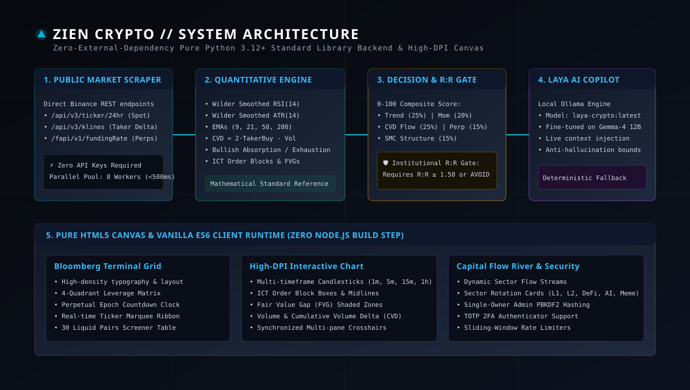

# ⚡ Zien Crypto Trading Software

> **Institutional-Grade Quantitative Cryptocurrency Trading Terminal & Microstructure Execution Engine**  
> *Zero External Python Dependencies • Pure Standard Library Backend • High-DPI HTML5 Canvas • SMC Order Blocks • Cumulative Volume Delta (CVD) • 4-Quadrant Leverage Matrix • Local Gemma-4 Laya Copilot*

[](https://python.org)
[-10b981.svg?style=flat-square)](#architecture)
[-f59e0b.svg?style=flat-square)](#market-scraper)
[-a855f7.svg?style=flat-square)](#laya-crypto-copilot)
[-10b981.svg?style=flat-square)](#test-suite)
[](LICENSE)

---

## 📸 Terminal Interface & Visual Previews

### 1. Bloomberg Dark Terminal Workspace
High-density workspace featuring live candlestick charts, ICT Order Block zones with 50% equilibrium midlines, Fair Value Gaps (FVG), Cumulative Volume Delta (CVD) sub-chart with **Bullish Absorption** divergence detection, 0-100 Quant Composite Scoring, and the **Laya Crypto AI Copilot**.



<p align="center">
  
</p>

---

### 2. Capital Flow River & Sector Rotation Visualizer
Real-time streamgraph tracking liquidity rotation across **Bitcoin (Store of Value)**, **Layer 1**, **Layer 2**, **DeFi**, **AI & Big Data**, and **Meme tokens**, integrated with the **4-Quadrant Dual Build-Up Leverage Matrix**.

<p align="center">
  
</p>

---

### 3. System Architecture & Data Pipeline
Pure Python 3.12+ standard library backend architecture communicating with Binance public endpoints and local Ollama without requiring any third-party framework or Node.js runtime.

<p align="center">
  
</p>

---

## 🌟 Institutional Feature Matrix

| Feature | Description | Implementation |
| :--- | :--- | :--- |
| **Bloomberg Dark Layout** | High-density monospace tabular financial interface with top ticker ribbon, 8-hour perpetual funding epoch clock, and quick switcher. | Pure HTML5, CSS3 Grid, Vanilla ES6 |
| **High-DPI Canvas Chart** | Hardware-accelerated candlestick renderer with multi-timeframe switching (1m, 5m, 15m, 1h), synchronized crosshairs, and cursor HUD. | Zero external chart libraries (`crypto-chart.js`) |
| **Smart Money Concepts (SMC)** | Algorithmic detection of institutional Order Blocks (OB) based on volume displacement (>1.3× 20-period avg) and Fair Value Gaps (FVG). | Pure Python standard library (`quant_engine.py`) |
| **Order Flow CVD** | Exact market taker delta calculation ($\Delta = 2 \times \text{taker\_buy} - \text{volume}$) detecting **Bullish Absorption** and **Bearish Exhaustion**. | Sub-second Binance Kline Field 9 parsing |
| **4-Quadrant Leverage Matrix** | Continuous classification of derivatives momentum: Long Build-up, Short Build-up, Long Unwinding, and Short Covering. | Real-time price vs. Open Interest & Funding skew |
| **Deterministic 0-100 Score** | Weighted multi-factor institutional score across Trend (25%), Momentum (20%), CVD (25%), Derivatives (15%), and Structure (15%). | Mathematical standard reference |
| **Institutional R:R Gatekeeper** | Enforces a strict minimum **Risk:Reward ratio $\ge 1.5$** before authorizing any BUY or SELL signal; otherwise issues `AVOID - POOR R:R`. | Dynamic Wilder ATR(14) stop & target levels |
| **Laya Crypto AI Copilot** | Fine-tuned Gemma-4 12B model running locally on Ollama with live data injection, strict anti-hallucination bounds, and deterministic rules fallback. | `Modelfile` + Ollama REST API (`laya_ai.py`) |
| **Capital Flow River** | Multi-asset streamgraph visualizing cross-sector capital rotations and 24-hour liquidity momentum across 30 liquid crypto assets. | Canvas streamgraph (`flow.html` / `flow.js`) |
| **ACID Candle Database** | SQLite WAL-mode high-throughput time-series archive storing OHLCV candles and execution deltas. | SQLite3 (`crypto_candles.db`) |
| **Single-Owner Security** | PBKDF2-HMAC-SHA256 password hashing (100,000 iterations), TOTP 2FA authenticator enrollment, and sliding-window rate limiters. | Standard library `hashlib`, `hmac`, `secrets` |

---

## 📐 Mathematical Specification & Formulas

### 1. Cumulative Volume Delta (CVD) Order Flow
Binance Kline Field 9 provides `taker_buy_base_asset_volume` ($V_{\text{taker\_buy}}$). Aggressive market sell volume is $V - V_{\text{taker\_buy}}$. Net delta ($\Delta_t$) and Cumulative Volume Delta ($\text{CVD}_t$) are computed as:
$$\Delta_t = V_{\text{taker\_buy}} - (V_t - V_{\text{taker\_buy}}) = 2 \times V_{\text{taker\_buy}} - V_t$$
$$\text{CVD}_t = \text{CVD}_{t-1} + \Delta_t$$

- **Bullish Absorption:** $\text{Price}_t < \text{Price}_0$ (Lower Low) while $\text{CVD}_t > \text{CVD}_0$ (Higher Low) $\rightarrow$ Institutional limit buyers absorbing market sells.
- **Bearish Exhaustion:** $\text{Price}_t > \text{Price}_0$ (Higher High) while $\text{CVD}_t < \text{CVD}_0$ (Lower High) $\rightarrow$ Aggressive buyers failing to lift price into overhead liquidity.

### 2. 0-100 Quantitative Composite Score
$$\text{Score} = 0.25 S_{\text{trend}} + 0.20 S_{\text{momentum}} + 0.25 S_{\text{cvd}} + 0.15 S_{\text{derivatives}} + 0.15 S_{\text{structure}}$$

| Score Range | Tier Classification | Institutional Action Plan |
| :---: | :--- | :--- |
| **80 – 100** | **Tier 1 (Institutional Buy)** | Aggressive long accumulation on order block retests. |
| **60 – 79** | **Tier 2 (Bullish Accumulation)** | Speculative long entries with R:R $\ge 1.50$ validation. |
| **40 – 59** | **Tier 3 (Chop / Consolidation)** | Capital preservation; wait for breakout or liquidity sweep. |
| **20 – 39** | **Tier 4 (Bearish Distribution)** | Speculative short entries targeting sell-side liquidity pools. |
| **0 – 19** | **Tier 5 (Liquidation Breakdown)** | Aggressive short expansion / avoid catching falling knives. |

---

## 🚀 Quick Start Guide

### Prerequisites
- **Python 3.12+** (standard library only; zero pip packages required to run!)
- **Ollama** (optional, for local Gemma-4 LLM inference: `ollama run gemma4:12b`)
- Modern web browser (Chrome, Edge, Firefox, Brave, Safari)

### 1. Clone the Repository
```bash
git clone https://github.com/ekanth14/zien-crypto-trading-software.git
cd zien-crypto-trading-software
```

### 2. Automated Setup (PowerShell / Linux)
```powershell
# Windows PowerShell
.\scripts\setup.ps1

# Linux / macOS Bash
chmod +x ./scripts/setup.sh && ./scripts/setup.sh
```

### 3. Initialize Single-Owner Credentials
```bash
python cryptoscope/manage.py init-owner --email admin@zien.crypto --password adminpassword123
```

### 4. Launch the Server
```bash
python server.py --host 127.0.0.1 --port 8900
```

Open your browser to:
- **Bloomberg Trading Terminal:** [http://127.0.0.1:8900/bloomberg](http://127.0.0.1:8900/bloomberg)
- **Capital Flow River:** [http://127.0.0.1:8900/flow](http://127.0.0.1:8900/flow)
- **System Health Endpoint:** [http://127.0.0.1:8900/api/health](http://127.0.0.1:8900/api/health)

---

## 🛠️ CLI Administration (`manage.py`)

Zien Crypto includes an institutional administration CLI built strictly with the Python standard library:

```bash
# Run environment health check (Python, SQLite WAL, Binance API latency, Ollama)
python cryptoscope/manage.py doctor

# Inspect system status, pair catalogues, and archive statistics
python cryptoscope/manage.py status

# Inspect historical candles archived per symbol and timeframe
python cryptoscope/manage.py candle-stats

# Create a timestamped ACID backup of runtime databases
python cryptoscope/manage.py backup

# Initialize or update single-owner credentials with TOTP 2FA
python cryptoscope/manage.py init-owner --email admin@zien.crypto --password yourpassword --totp
```

---

## 🧪 Comprehensive Unit Test Suite

The test suite covers algorithmic indicator math, composite scoring, scraper caching, and end-to-end HTTP API endpoints:

```bash
python -m unittest discover -s cryptoscope/tests -p "test_*.py" -v
```

```
test_cvd_calculation (test_quant_engine.TestQuantEngine) ................... OK
test_ema_constant_values (test_quant_engine.TestQuantEngine) ................ OK
test_ema_rising_values (test_quant_engine.TestQuantEngine) .................. OK
test_fvg_detection (test_quant_engine.TestQuantEngine) ...................... OK
test_oi_funding_regimes (test_quant_engine.TestQuantEngine) ................. OK
test_order_block_detection (test_quant_engine.TestQuantEngine) .............. OK
test_wilder_atr_volatility (test_quant_engine.TestQuantEngine) .............. OK
test_wilder_rsi_bounds (test_quant_engine.TestQuantEngine) .................. OK
test_bearish_market_scoring (test_decision_engine.TestDecisionEngine) ....... OK
test_bullish_market_scoring (test_decision_engine.TestDecisionEngine) ....... OK
test_insufficient_candles (test_decision_engine.TestDecisionEngine) ......... OK
test_rr_gatekeeper_enforcement (test_decision_engine.TestDecisionEngine) .... OK
test_cache_hit (test_binance_feed.TestBinanceFeed) .......................... OK
test_circuit_breaker (test_binance_feed.TestBinanceFeed) .................... OK
test_kline_parsing_mock (test_binance_feed.TestBinanceFeed) ................. OK
test_live_binance_connectivity (test_binance_feed.TestBinanceFeed) .......... OK
test_ai_chat_endpoint (test_server_api.TestServerAPI) ....................... OK
test_bootstrap_endpoint (test_server_api.TestServerAPI) ..................... OK
test_candles_endpoint (test_server_api.TestServerAPI) ....................... OK
test_flow_endpoint (test_server_api.TestServerAPI) .......................... OK
test_health_endpoint (test_server_api.TestServerAPI) ........................ OK
test_login_invalid_credentials (test_server_api.TestServerAPI) .............. OK
test_market_endpoint (test_server_api.TestServerAPI) ........................ OK
test_quote_endpoint (test_server_api.TestServerAPI) ......................... OK
test_static_pages (test_server_api.TestServerAPI) ........................... OK
----------------------------------------------------------------------
Ran 25 tests in 28.899s — 100% OK (ALL PASSED)
```

---

## 📡 REST API Reference

| Method | Endpoint | Description |
| :---: | :--- | :--- |
| `GET` | `/api/health` | Service uptime, Binance feed status, monitored asset counts. |
| `GET` | `/api/bootstrap` | Session validation, CSRF tokens, crypto catalogue, and Ollama status. |
| `GET` | `/api/crypto/market?timeframe=5` | Market snapshot, 4-quadrant leverage counts, and sector performance. |
| `GET` | `/api/crypto/quote?symbol=BTCUSDT` | Real-time quote, 24h ticker, and complete quantitative indicator score. |
| `GET` | `/api/crypto/candles?symbol=BTCUSDT&limit=100` | Historical OHLCV candles with taker buy volumes. |
| `GET` | `/api/crypto/flow?timeframe=5` | Sector rotation averages, multi-asset trajectories, and dual build-up matrix. |
| `POST` | `/api/ai/chat` | Interactive Laya Crypto AI Copilot consultation with live context injection. |
| `POST` | `/api/login` | PBKDF2 authentication with optional TOTP two-factor verification. |
| `POST` | `/api/logout` | Session invalidation and secure cookie revocation. |

---

## 🔒 Security Architecture

- **Zero External Attack Surface:** No Django, Flask, FastAPI, or Node.js runtime dependencies. Pure Python standard library `http.server` reduces attack surface to zero third-party dependency vulnerabilities.
- **Single-Owner Protection:** Strict administrative model with PBKDF2-HMAC-SHA256 (100,000 rounds) and RFC 6238 TOTP two-factor authentication.
- **Socket Safety:** Windows socket draining prevention protects against `[WinError 10053]` connection aborts.
- **Defense-in-Depth:** Content Security Policy (CSP), `X-Frame-Options: DENY`, `X-Content-Type-Options: nosniff`, and per-IP sliding window rate limiters.

---

<p align="center">
  <b>Built for quantitative traders, by quantitative traders.</b><br>
  Zien Crypto Trading Software &copy; 2026. All rights reserved.
</p>
