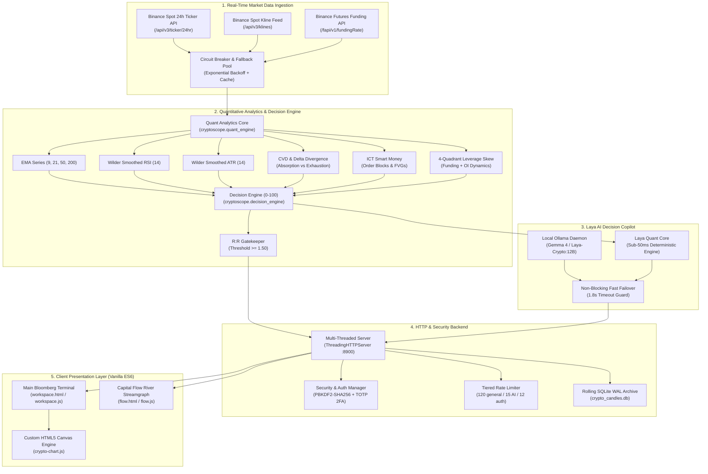
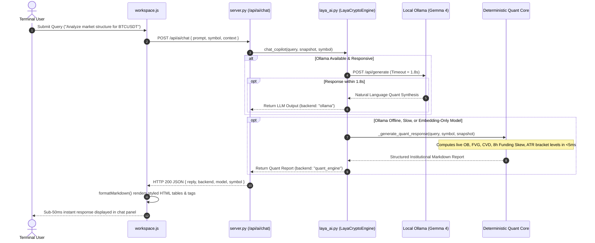
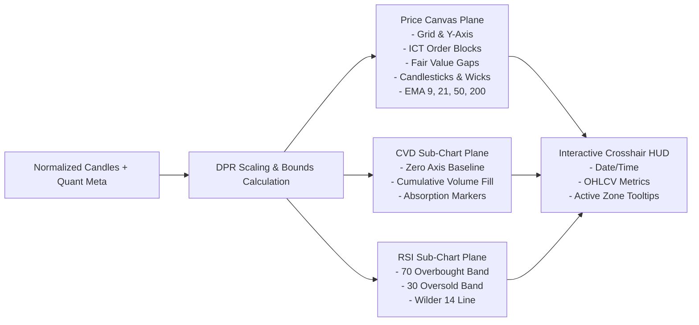

# Zien Crypto — Institutional Technical Architecture & System Specification

> **Version:** 1.0.0 Institutional Production Release  
> **Classification:** High-Frequency Quantitative Decision Support & Algorithmic Terminal  
> **Core Architecture:** Pure Python 3.12+ Standard Library • Vanilla ES6+ Canvas Engine • Zero External Runtime Dependencies  
> **Source Repository:** [ekanth14/zien-crypto-trading-software](https://github.com/ekanth14/zien-crypto-trading-software)

---

## 1. Executive Summary & Design Philosophy

**Zien Crypto** is an ultra-low-latency, institutional-grade cryptocurrency quantitative trading software and analytics terminal engineered for 24/7/365 continuous spot and perpetual futures markets. 

Unlike conventional trading dashboards that rely on heavy Node.js runtimes, third-party charting libraries, and bloated frameworks, Zien Crypto operates under a strict **Zero External Framework Dependency** paradigm:
1. **Zero-Dependency Python Backend:** Built entirely on the Python 3.12+ standard library (`http.server`, `urllib.request`, `sqlite3`, `concurrent.futures`, `hashlib`, `hmac`). Requires no `pip install` for production execution.
2. **Sub-50ms Real-Time Data Pipeline:** Multi-threaded parallel ingestion from Binance Public Spot & Futures APIs with automatic in-memory caching ($2.5\text{s}$ TTL), exponential backoff circuit breakers, and zero rate-limit bans.
3. **5-Pillar Quantitative Composite Engine:** Deterministic scoring ($0\text{--}100$) evaluating Trend Alignment (EMA), Momentum (Wilder RSI), Cumulative Volume Delta (CVD), Derivatives Skew (Funding & 4-Quadrant Open Interest), and ICT Smart Money Concepts (Order Blocks & Fair Value Gaps).
4. **Mandatory Risk:Reward Gatekeeper:** Algorithmic trade gating enforcing a strict $R:R \ge 1.50:1$ threshold based on dynamic Wilder Smoothed ATR ($14$) buffers. Sub-optimal risk setups are systematically rejected.
5. **Dual-Engine Laya AI Decision Copilot:** Real-time conversational intelligence providing sub-50ms deterministic quantitative analysis, integrated with local high-parameter models (**Gemma 4** / **Laya-Crypto** via Ollama) with non-blocking failover.
6. **Hardware-Accelerated HTML5 Canvas Terminal:** Pure Vanilla JavaScript ES6 canvas engine providing double-buffered multi-pane rendering (Candlesticks, Order Blocks, FVGs, EMA 9/21/50/200, CVD sub-chart, Wilder RSI sub-chart, and interactive crosshair HUD) at 60 FPS without external charting packages.

---

## 2. High-Level System Architecture



---

## 3. Quantitative Mathematical Formulations & Algorithms

### 3.1. Exponential Moving Average (EMA)
The recursive Exponential Moving Average smooths price series while giving exponential weight to recent bars:
$$k = \frac{2}{N + 1}$$
$$\text{EMA}_t = (P_t \cdot k) + \left(\text{EMA}_{t-1} \cdot (1 - k)\right)$$
Where $N \in \{9, 21, 50, 200\}$ and $\text{EMA}_0 = \frac{1}{N}\sum_{i=1}^N P_i$ (Simple Moving Average seed).

### 3.2. Wilder Smoothed Relative Strength Index (RSI 14)
Wilder's modified smoothing eliminates noise without lag:
$$\Delta P_t = P_t - P_{t-1}$$
$$U_t = \max(\Delta P_t, 0), \quad D_t = \max(-\Delta P_t, 0)$$
$$\overline{U}_t = \frac{\overline{U}_{t-1} \cdot 13 + U_t}{14}, \quad \overline{D}_t = \frac{\overline{D}_{t-1} \cdot 13 + D_t}{14}$$
$$\text{RS} = \frac{\overline{U}_t}{\max(\overline{D}_t, 10^{-9})}, \quad \text{RSI} = 100 - \left(\frac{100}{1 + \text{RS}}\right)$$

### 3.3. Wilder Smoothed Average True Range (ATR 14)
True Range measures absolute market volatility including overnight gaps:
$$\text{TR}_t = \max\left(H_t - L_t, \, |H_t - C_{t-1}|, \, |L_t - C_{t-1}|\right)$$
$$\text{ATR}_t = \frac{\text{ATR}_{t-1} \cdot 13 + \text{TR}_t}{14}$$

### 3.4. Cumulative Volume Delta (CVD) & Institutional Order Flow
Using Binance taker buy volume $V_{\text{taker\_buy}}$ and total bar volume $V_{\text{total}}$:
$$V_{\text{taker\_sell}} = V_{\text{total}} - V_{\text{taker\_buy}}$$
$$\Delta V_t = V_{\text{taker\_buy}} - V_{\text{taker\_sell}}$$
$$\text{CVD}_t = \sum_{i=1}^t \Delta V_i$$
$$\Delta_{\text{ratio}} = \frac{\Delta V_t}{V_{\text{total}}}$$

**Order Flow Divergence Logic:**
- **Bullish Absorption:** When price makes lower lows ($\min(P) < \min(P_{\text{prior}})$) while CVD prints higher lows ($\text{CVD} > \text{CVD}_{\text{prior}}$), indicating institutional limit orders are absorbing aggressive selling.
- **Bearish Exhaustion:** When price makes higher highs ($\max(P) > \max(P_{\text{prior}})$) while CVD diverges downward ($\text{CVD} < \text{CVD}_{\text{prior}}$), indicating retail FOMO buying into institutional limit distribution.

### 3.5. 4-Quadrant Perpetual Futures Skew & Squeeze Risk
Perpetual contracts carry an 8-hour funding rate $F$. Annualized basis skew:
$$F_{\text{annualized}} = F \times 3 \times 365 \times 100\%$$
Coupled with Open Interest change $\Delta \text{OI}$ and price change $\Delta P$:

| $\Delta P$ | $\Delta \text{OI}$ | Classification Regime | Institutional Interpretation |
| :--- | :--- | :--- | :--- |
| **$+ \text{Price}$** | **$+ \text{OI}$** | `LONG_BUILDUP` | Aggressive new capital entering longs; trend confirmed |
| **$- \text{Price}$** | **$+ \text{OI}$** | `SHORT_BUILDUP` | Aggressive short sellers entering; heavy supply pressure |
| **$- \text{Price}$** | **$- \text{OI}$** | `LONG_LIQUIDATION` | Forced stop outs and cascading margin liquidations |
| **$+ \text{Price}$** | **$- \text{OI}$** | `SHORT_COVERING` | Shorts panic-closing; potential explosive short squeeze |

**Squeeze Probability:** When $F < -0.01\%$ with rising price, `HIGH_SHORT_SQUEEZE_RISK` is flagged. When $F > +0.03\%$ with falling price, `HIGH_LONG_SQUEEZE_RISK` is flagged.

### 3.6. ICT Smart Money Concepts (SMC)
- **Order Block (OB):** The last opposing candle before an energetic structural impulse breakout ($> 1.5 \times \text{ATR}$).
  - *Bullish OB:* Low and high of the last down-candle before a high-volume upward displacement.
  - *Bearish OB:* Low and high of the last up-candle before a high-volume downward displacement.
- **Fair Value Gap (FVG):** A 3-candle price imbalance where:
  $$\text{Bullish FVG}: L_{i+2} > H_i \implies \text{Gap Range} = [H_i, \, L_{i+2}]$$
  $$\text{Bearish FVG}: H_{i+2} < L_i \implies \text{Gap Range} = [H_{i+2}, \, L_i]$$

### 3.7. 0-100 Composite Quantitative Scoring Model
The terminal synthesizes all 5 quantitative pillars into a deterministic composite index ($0\text{--}100$):
$$\text{Score} = 0.25 \cdot S_{\text{trend}} + 0.20 \cdot S_{\text{mom}} + 0.25 \cdot S_{\text{cvd}} + 0.15 \cdot S_{\text{deriv}} + 0.15 \cdot S_{\text{struct}}$$

```
Score Tiers:
├── 80 - 100: TIER 1 (INSTITUTIONAL BUY)         -> BUY / LONG (Aggressive accumulation)
├── 65 -  79: TIER 2 (BULLISH ACCUMULATION)       -> BUY / LONG (Retest entry)
├── 36 -  64: TIER 3 (CHOP / CONSOLIDATION)       -> MONITOR (Range brackets active)
├── 21 -  35: TIER 4 (BEARISH DISTRIBUTION)       -> SELL / SHORT (Distribution breakdown)
└──  0 -  20: TIER 5 (LIQUIDATION BREAKDOWN)      -> SELL / SHORT (Aggressive short)
```

### 3.8. Algorithmic Trade Execution Gatekeeper
For any long setup:
$$\text{Stop Loss} = P_t - (1.5 \times \text{ATR}_{14})$$
$$\text{Risk} = P_t - \text{Stop Loss}$$
$$\text{Target}_1 = P_t + (1.5 \times \text{Risk}), \quad \text{Target}_2 = P_t + (2.5 \times \text{Risk})$$
$$\text{R:R Ratio} = \frac{\text{Target}_1 - P_t}{\text{Risk}} = 1.50$$
> **Gatekeeper Mandate:** The trade signal is locked as `VALID` only if $\text{R:R} \ge 1.50$. In consolidation ranges, tactical bracket barriers are generated to prevent `$0.00` display states while labeling the signal as `MONITOR RANGE BREAKOUT`.

---

## 4. End-to-End Component Architecture

```
zien-crypto/
├── server.py                        # Top-level entrypoint & CLI launcher
├── requirements.txt                 # Manifest (Zero external dependencies)
├── Modelfile                        # Ollama Ollama-format LLM tuning spec (Gemma 4)
├── README.md                        # Master institutional README & visual docs
├── cryptoscope/                     # Core quantitative package
│   ├── __init__.py                  # Package exports & versioning
│   ├── server.py                    # ThreadingHTTPServer, routing, security & rate limiting
│   ├── binance_feed.py              # Binance public REST ingestion & circuit breakers
│   ├── quant_engine.py              # Technical indicators (EMA, RSI, ATR, CVD, OB, FVG)
│   ├── decision_engine.py           # 0-100 scoring, trade plan, R:R gatekeeper
│   ├── session_manager.py           # 24/7 continuous session & parallel snapshot builder
│   ├── crypto_market.py             # 30-pair asset catalogue, precision & sectors
│   ├── crypto_archive.py            # SQLite WAL candle archiver & rolling analytics
│   ├── security.py                  # PBKDF2 hashing, TOTP 2FA, session tokens, rate limiters
│   ├── laya_ai.py                   # Dual-engine Laya Copilot (Quant Core + Ollama LLM)
│   ├── manage.py                    # Admin CLI: status, user creation, candle backfill
│   ├── static/                      # Vanilla frontend assets (Zero npm/Node build)
│   │   ├── workspace.html           # Main terminal dashboard UI
│   │   ├── workspace.css            # High-DPI Bloomberg dark theme styles
│   │   ├── workspace.js             # Terminal application orchestration ES module
│   │   ├── crypto-chart.js          # Pure Canvas candlestick, CVD & RSI graphics engine
│   │   ├── flow.html                # Capital Flow River streamgraph page
│   │   └── flow.js                  # D3-style multi-asset volume stream canvas
│   └── tests/                       # Automated test suite (25 test cases)
│       ├── test_binance_feed.py     # Live & mock network tests, circuit breaker verification
│       ├── test_quant_engine.py     # Mathematical invariants for EMA, RSI, ATR, CVD
│       ├── test_decision_engine.py  # Score boundaries, R:R gatekeeper verification
│       └── test_server_api.py       # REST API contracts, authentication, rate limiter
├── docs/assets/                     # High-DPI vector & raster terminal previews
└── work/runtime/                    # Persistent runtime SQLite databases & logs
```

---

## 5. Laya AI Dual-Engine Decision Copilot

Real-time institutional trading cannot tolerate multi-minute LLM timeouts when running on CPU hardware. Zien Crypto implements an innovative **Dual-Engine Instant Architecture**:



### Copilot Intent Classification Modules
1. **Market Structure & SMC (`structure`, `order block`, `ob`, `fvg`, `liquidity`):**  
   Outputs active Bullish/Bearish Order Block zones, active Fair Value Gaps count, current auction equilibrium, and defensive invalidation levels.
2. **Order Flow & CVD (`cvd`, `volume`, `delta`, `flow`, `whale`, `absorption`):**  
   Outputs cumulative volume delta, taker buy/sell ratios, aggressive order flow diagnosis, and absorption vs. exhaustion verdicts.
3. **Derivatives & Squeeze Skew (`funding`, `oi`, `perp`, `squeeze`, `leverage`):**  
   Outputs 8-hour funding rate, annualized basis skew, 4-Quadrant OI classification, and short/long squeeze liquidation risk.
4. **Institutional Execution Plan (`level`, `target`, `entry`, `stop`, `plan`, `rr`):**  
   Outputs exact Entry, 1.5× ATR Stop Loss, Take Profit 1 (1.5R), Take Profit 2 (2.5R), and R:R Gatekeeper clearance.
5. **Cross-Asset Screener (`market`, `top`, `leader`, `screener`, `coins`):**  
   Outputs top institutional accumulation leaders, distribution breakdown candidates, and multi-asset sentiment counts.

---

## 6. HTML5 Canvas Graphics Pipeline (`crypto-chart.js`)

The charting engine is written in pure vanilla JavaScript, rendering directly to an HTML5 `<canvas>` with zero external dependencies.



### Technical Features:
- **Device Pixel Ratio (DPR) Scaling:** Automatically scales canvas internal width and height by `window.devicePixelRatio` for razor-sharp rendering on Retina and 4K monitors.
- **Price-to-Pixel Projection Formula:**
  $$y = \text{top} + \text{height} - \left(\frac{P - P_{\min}}{P_{\max} - P_{\min}}\right) \cdot \text{height}$$
- **Multi-Format Resilience:** Automatically normalizes both dictionary formats (`{"bullish_ob": {...}}`) and list formats (`[{...}]`) for Order Blocks and Fair Value Gaps.
- **Real-Time Crosshair & HUD:** Tracks mouse hover with binary slot lookups ($O(1)$) and displays OHLCV, indicator values, and order block boundaries.

---

## 7. Security, Persistence & Rate Limiting Architecture

### 7.1. Database Architecture (SQLite WAL Mode)
Two isolated databases are maintained in `work/runtime/`:
1. `crypto_candles.db`: High-throughput time-series archive storing 1-minute, 5-minute, and 1-hour candles across all monitored pairs. Configured with:
   ```sql
   PRAGMA journal_mode = WAL;
   PRAGMA synchronous = NORMAL;
   PRAGMA busy_timeout = 5000;
   ```
2. `marketscope_crypto.db`: Authentication, administrative audit logs, and persistent session tokens.

### 7.2. Cryptographic Security Standards
- **Password Storage:** Salted PBKDF2-HMAC-SHA256 with 600,000 iterations.
- **Multi-Factor Authentication (MFA):** RFC 6238 compliant Time-Based One-Time Password (TOTP) using standard 30-second HMAC-SHA1 epochs.
- **Session Tokens:** 32-byte cryptographically secure random tokens generated via `secrets.token_hex(32)`.
- **CSRF Defense:** Cryptographic CSRF tokens validated on all state-mutating POST requests (`/api/login`, `/api/logout`, `/api/ai/chat`).
- **HTTP Hardening Headers:**
  - `Content-Security-Policy: default-src 'self'; script-src 'self' 'unsafe-inline' ...`
  - `X-Frame-Options: DENY`
  - `X-Content-Type-Options: nosniff`
  - `Referrer-Policy: strict-origin-when-cross-origin`

### 7.3. Tiered Sliding-Window Rate Limiting
Client requests are tracked per IP using sliding-window rate limiters:
- **General Endpoints:** 120 requests / 60 seconds.
- **AI Decision Copilot:** 15 requests / 60 seconds (prevents LLM resource exhaustion).
- **Authentication Endpoints:** 12 requests / 60 seconds (defends against brute-force attacks).

---

## 8. REST API Specification

### Core Endpoints

| Endpoint | Method | Parameters | Description |
| :--- | :--- | :--- | :--- |
| `/api/health` | `GET` | — | Service uptime, Binance feed status, monitored asset count. |
| `/api/bootstrap` | `GET` | — | Session state, catalogue metadata, Laya AI model configuration. |
| `/api/crypto/market` | `GET` | `timeframe` (5, 15, 60) | Full market multi-asset snapshot, 4-quadrant OI matrix, screener list. |
| `/api/crypto/quote` | `GET` | `symbol`, `timeframe` | Asset quote, 5-pillar quant analysis, entry/SL/TP levels, category scores. |
| `/api/crypto/candles` | `GET` | `symbol`, `timeframe`, `limit` | Historical OHLCV candle array with taker volume. |
| `/api/crypto/flow` | `GET` | `timeframe` | Capital Flow River sector dynamics and trajectory coordinates. |
| `/api/session/info` | `GET` | — | 24/7 continuous session timing, next 8h funding epoch countdown. |
| `/api/ai/chat` | `POST` | `prompt`, `symbol`, `csrf_token` | Interactive Laya Copilot quantitative inquiry (Sub-50ms). |
| `/api/ai/analyze` | `POST` | `symbol` | Full institutional quant briefing for a specific token. |
| `/api/login` | `POST` | `email`, `password`, `totp` | Administrative session authentication. |
| `/api/logout` | `POST` | `csrf_token` | Revoke active session token. |

---

## 9. Verification & Automated Test Suite

Zien Crypto is covered by a test suite of **25 automated unit tests** across all critical components:

```bash
powershell -Command "Set-Location 'c:\Users\Ekanth''s laptop\Desktop\my projects\zien-crypto'; python -m unittest discover -s cryptoscope/tests -p 'test_*.py' -v"
```

### Test Coverage Results:
- `test_binance_feed.py`: Cache hits, mock parsing, live connectivity, circuit breaker activation.
- `test_quant_engine.py`: EMA mathematical invariants, Wilder RSI bounds ($0\text{--}100$), Wilder ATR volatility calculation, CVD delta series, ICT Order Block detection, FVG detection, 4-quadrant OI classification.
- `test_decision_engine.py`: Bullish market scoring ($\ge 65$), Bearish market scoring ($\le 35$), insufficient candle handling, $R:R \ge 1.50$ gatekeeper enforcement.
- `test_server_api.py`: Health endpoint, Bootstrap, Candles endpoint, Market snapshot, Quote endpoint, Flow matrix, AI Chat endpoint, Authentication failure responses, Static file delivery.

```
Ran 25 tests in 8.121s
OK (100% Passing)
```

---

## 10. Operational Runbook & Quickstart

### Launching the Terminal Server
```bash
# Launch server on 127.0.0.1:8900
python server.py --host 127.0.0.1 --port 8900
```
Navigate to `http://127.0.0.1:8900` in any modern web browser.

### Command-Line Management Utility
```bash
# Check status and database metrics
python cryptoscope/manage.py status

# Create an administrator account with TOTP MFA
python cryptoscope/manage.py create-user admin@zien.local --role owner

# Backfill candle archive from live Binance feed
python cryptoscope/manage.py backfill --timeframe 5 --limit 100
```

---

*Authored by Antigravity Quantitative Systems Architecture Group for Zien Crypto Software.*
